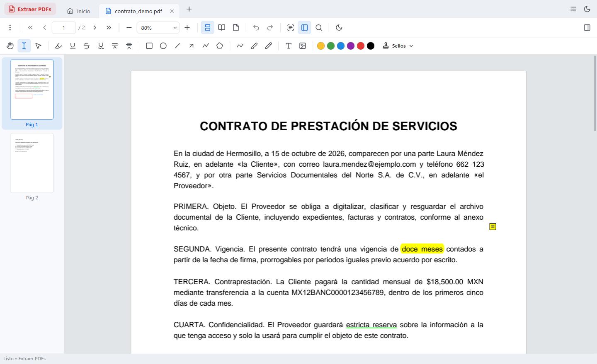
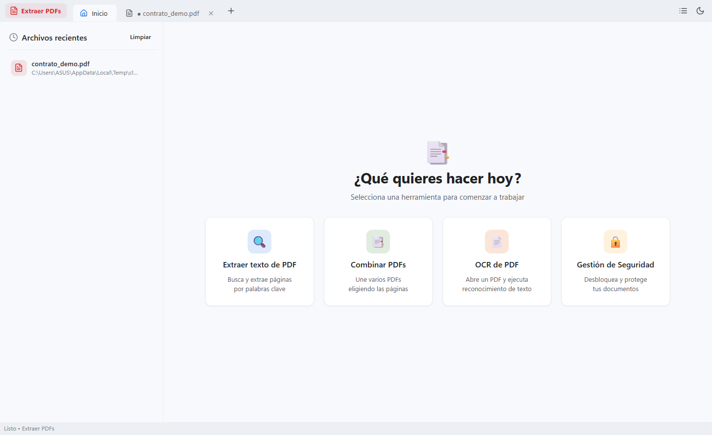
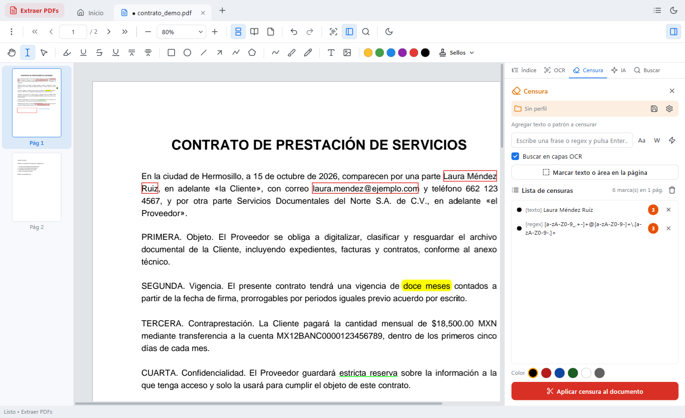
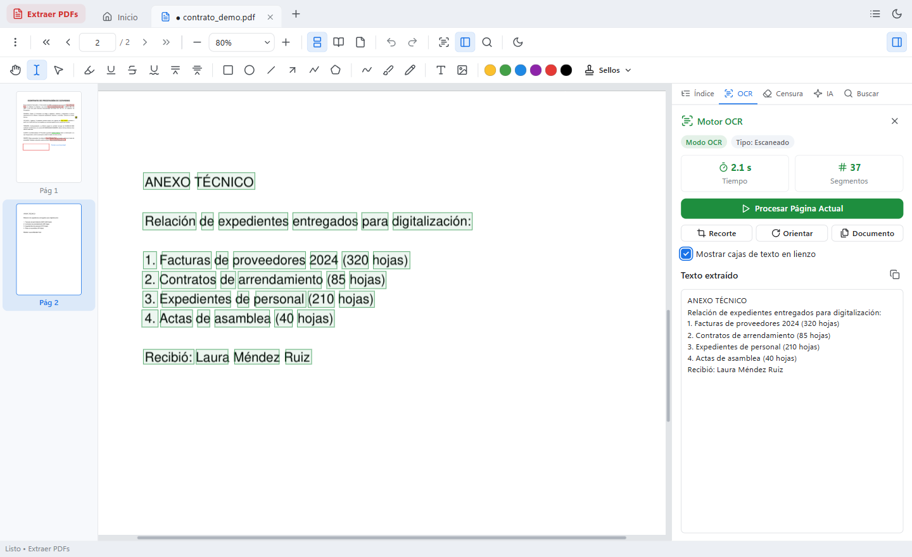
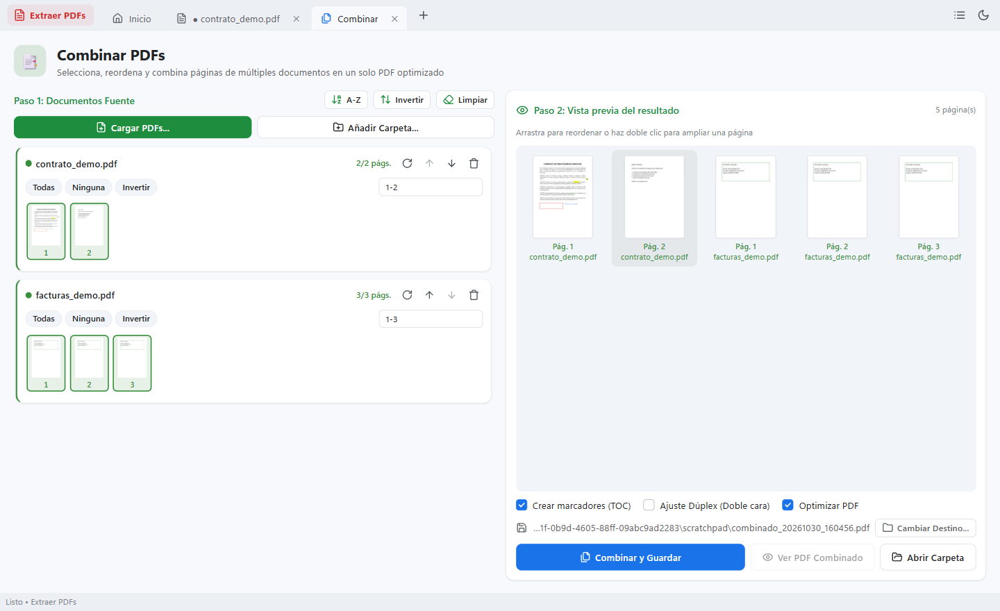
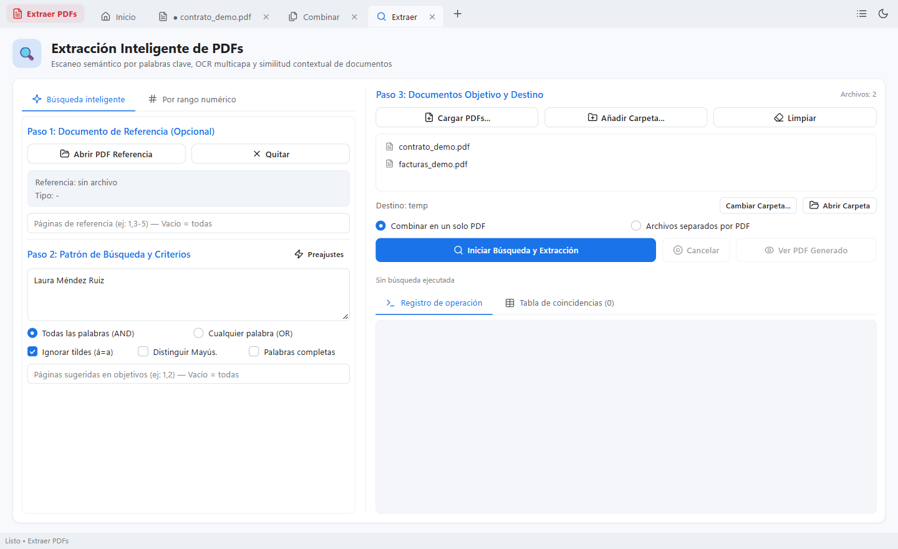
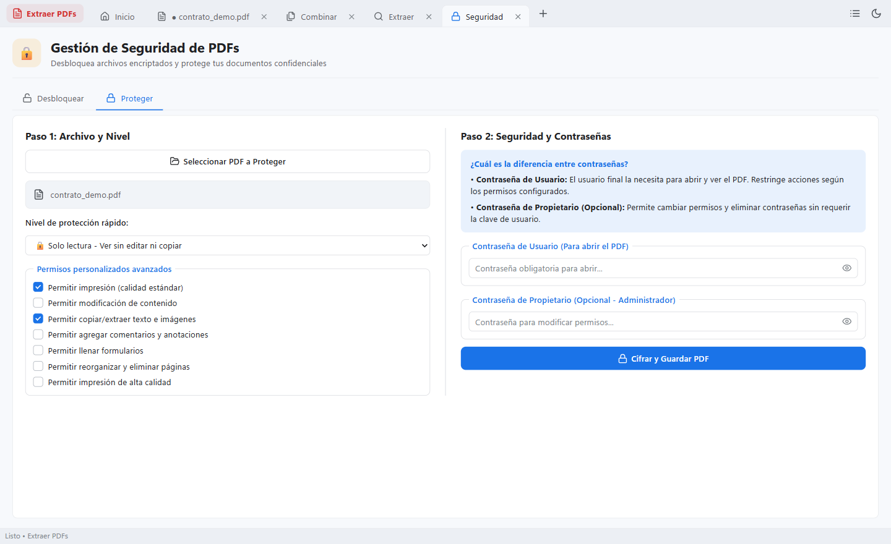

# PdfManager App

Aplicación de escritorio para Windows para ver, anotar, censurar y manipular archivos PDF, con OCR,
extracción por palabras clave, combinación y seguridad.



> **Versión web 0.1.29-web (en pruebas).** La interfaz ahora usa tecnología web (Svelte) dentro de
> una ventana de escritorio (pywebview + WebView2), con el backend en Python. La versión **Flet** se
> descarta: la 0.1.28 fue la última y queda respaldada en la rama `Flet`. Su código sigue en `src/`
> solo por compatibilidad y se retirará más adelante. Ver [docs/README.md](docs/README.md).

## Arquitectura

```
app/            aplicación: ventana (pywebview), arranque y servicios Python que llama la interfaz
app/ui/         interfaz en Svelte (compilada con Vite); el visor dibuja los PDF con EmbedPDF (PDFium)
src/pdf_core/   lógica de PDF sin interfaz (PyMuPDF, OCR, censura, combinar, seguridad...)
installer/web/  ejecutable (PyInstaller) e instalador (Inno Setup)
docs/web/       documentación de la versión web
```

La interfaz llama a los servicios de Python con `call('servicio.metodo', ...)`. EmbedPDF dibuja las
páginas y edita las anotaciones en la ventana; Python guarda el archivo y hace lo pesado (operaciones
de página, OCR, censura, IA, combinar y seguridad). Detalle en
[docs/web/arquitectura.md](docs/web/arquitectura.md).

## Características

### 🏠 Inicio
Accesos a cada herramienta y archivos recientes. Cada PDF y cada herramienta se abren en su pestaña.



### 📖 Visor de PDF
- Zoom, scroll continuo, doble página o página única, miniaturas, índice y modo noche.
- Selección de texto (también entre páginas) y búsqueda con lista de resultados.
- **Anotaciones:** resaltar, subrayar, tachar, formas, flechas, pluma, texto libre, notas, imágenes y
  sellos. Se mueven, se redimensionan y se cambian de color, grosor y orden.
- **Páginas:** girar, mover (también arrastrando miniaturas), duplicar, insertar, eliminar y extraer.
- Deshacer y rehacer (Ctrl+Z / Ctrl+Y) tanto las anotaciones como las operaciones de página.
- Imprimir con vista previa: páginas, orden, orientación, color y escala.
- Exportar el texto y las imágenes del documento.

📚 [Cómo está hecho el visor](docs/web/embedpdf.md)

### 🖍️ Censura
Marca lo que hay que tapar y revísalo en la página antes de aplicarlo:
- frases, expresiones regulares y patrones de datos personales (correos, teléfonos, tarjetas, RFC/CURP...);
- texto seleccionado y áreas dibujadas a mano;
- perfiles de censura guardados.

Cada coincidencia es una marca que se puede mover, borrar o deshacer. Al aplicar, el contenido de
debajo se borra para siempre y el documento solo se guarda como copia.



### 🔍 OCR
Reconoce el texto de páginas escaneadas (página actual, recorte o documento entero) y corrige la
orientación. El texto reconocido se puede seleccionar, buscar, censurar y exportar.



### ✨ Asistente IA (en pruebas)
Chat sobre el documento, resumen, datos clave y detección de datos sensibles (que se envían a
Censura). Sin clave de API responde en modo básico.

> ⚠️ El agente de IA está **en fase de pruebas** y todavía no está probado del todo. Sus
> dependencias no se instalan por defecto (están comentadas en `pyproject.toml`); sin ellas solo
> funciona el modo básico.

### 📄 Combinar PDF
Une varios PDF eligiendo, girando y reordenando las páginas, con vista previa del resultado.



### 📊 Extraer
Busca en varios PDF por palabras clave (o por rango de páginas) y genera un PDF con las páginas
encontradas.



### 🔐 Seguridad
- **Proteger:** contraseña de usuario y de propietario (AES-256) y permisos.
- **Desbloquear:** quita la protección de un PDF del que se conoce la contraseña.



## 🧪 Qué está en fase de pruebas

La 0.1.29-web es una versión de prueba. Funciona en general, pero estas partes todavía no se han
probado del todo con uso real:

| Aspecto | Estado |
|---|---|
| **Agente de IA** | En pruebas, no probado del todo. Sin sus dependencias (comentadas en `pyproject.toml`) ni clave de API responde en modo básico |
| **Censura con marcas** | Nueva: las marcas se revisan en la página y Python las aplica. Conviene revisar el resultado antes de compartir la copia censurada |
| **Deshacer operaciones de página** | Nuevo: Ctrl+Z / Ctrl+Y sobre girar, mover, insertar, duplicar y eliminar páginas, junto con las anotaciones |
| **Anotaciones** | Edición con EmbedPDF (mover, redimensionar, orden, texto libre). Probadas en pruebas automáticas, falta uso real con PDF variados |
| **Imprimir** | Nueva: las páginas las dibuja el visor (PDFium). Falta probar con distintas impresoras |
| **Instalador** | Probados la instalación, «Abrir con» y el OCR. Falta más uso en otros equipos |

## Instalación

Descarga el instalador `ExtraerPDFs_Web_Setup_<versión>.exe` de la página de
[Releases](https://github.com/Mahynlo/pdf_manager/releases). Añade «Abrir con» para los PDF y admite
arrastrar archivos a la ventana.

## Desarrollo

Requisitos: Windows, Python 3.10 o superior con [uv](https://docs.astral.sh/uv/), y Node.js con
pnpm (para compilar la interfaz).

```bash
git clone https://github.com/Mahynlo/pdf_manager.git
cd pdf_manager
uv sync
```

```bash
uv run python -m app.main            # arrancar (recompila la interfaz si cambió)
uv run python -m app.main --dev      # con el servidor de Vite: recarga al guardar
uv run python -m app.main --debug    # con herramientas de desarrollo (F12)
uv run pytest                        # pruebas
```

La primera vez, si falta `app/ui/node_modules`, se ejecuta `pnpm install` automáticamente. Más
detalles en [docs/web/svelte.md](docs/web/svelte.md).

## Compilación

```powershell
.\installer\web\build.ps1                  # ejecutable + instalador
.\installer\web\build.ps1 -SkipInstaller   # solo el ejecutable
```

El instalador necesita Inno Setup 6. En GitHub lo genera el workflow `build-web.yml` al subir una
etiqueta `v*-web` (por ejemplo `v0.1.29-web`). Detalle en
[docs/web/instalador.md](docs/web/instalador.md).


## Seguir usando la versión Flet

> ⚠️ **No se recomienda.** La versión Flet ya no recibirá cambios ni versiones nuevas; se mantiene
> solo por compatibilidad y más adelante se retirará de esta rama. Para uso normal, usa la versión web.

Si aun así la necesitas, sigue disponible:

- **En esta rama:** su código sigue en `src/` (con la lógica compartida de `src/pdf_core/`). Se
  arranca y se compila igual que antes:

  ```bash
  uv sync
  uv run flet run          # arrancar
  .\build.ps1              # exe + «Abrir con» + instalador (PowerShell, necesita Inno Setup)
  ```

  Ojo: aquí comparte `pdf_core` con la versión web, que ha cambiado desde la 0.1.28 (por ejemplo,
  los modelos de OCR), así que puede comportarse distinto que la versión publicada.
- **Instalador:** `v0.1.28`, la última versión de Flet, en
  [Releases](https://github.com/Mahynlo/pdf_manager/releases/tag/v0.1.28). Se puede instalar junto a
  la versión web, porque cada una tiene su propia carpeta e instalación.
- **Código tal como quedó en la 0.1.28:** rama [`Flet`](https://github.com/Mahynlo/pdf_manager/tree/Flet)
  (`git clone -b Flet https://github.com/Mahynlo/pdf_manager.git`).

Su documentación está en [docs/flet/](docs/flet/README.md).
