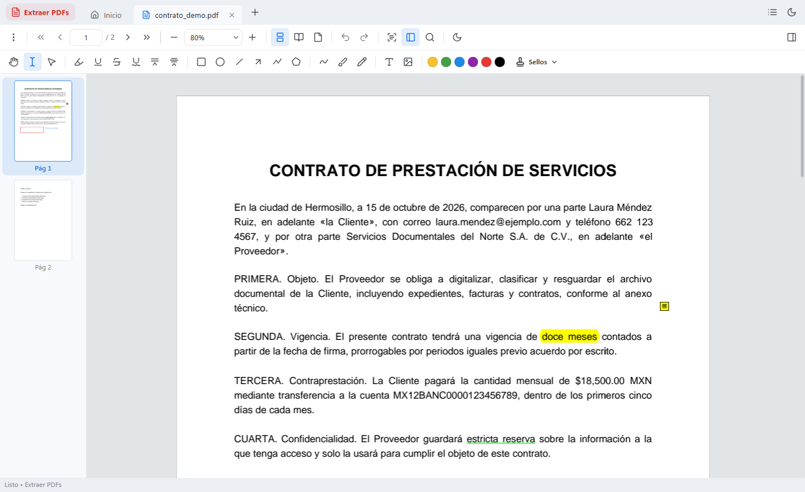
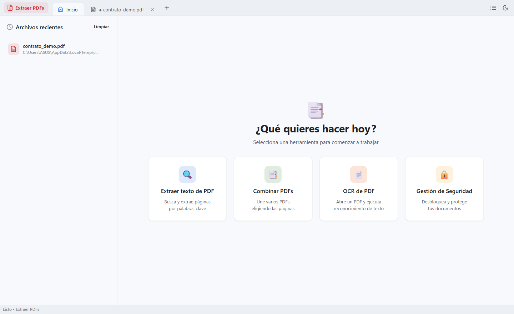
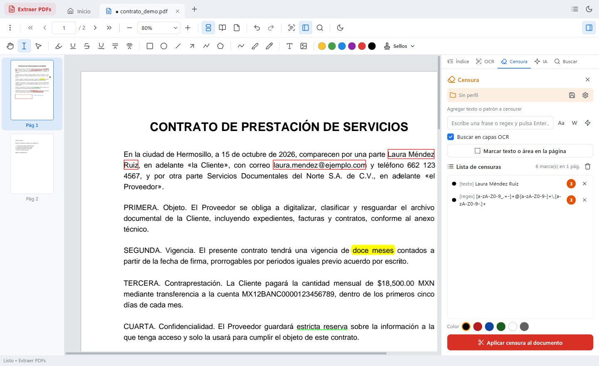
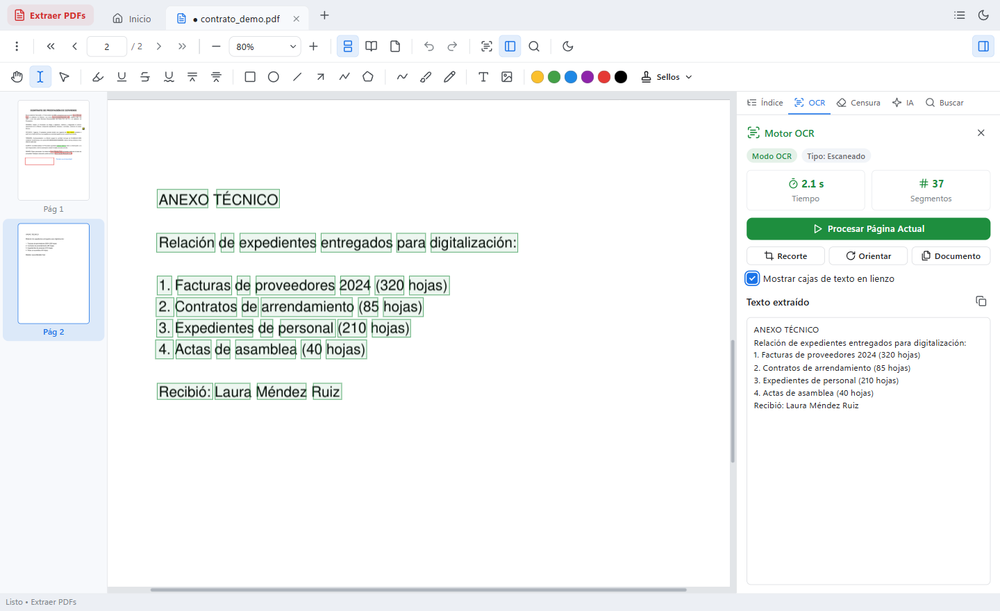
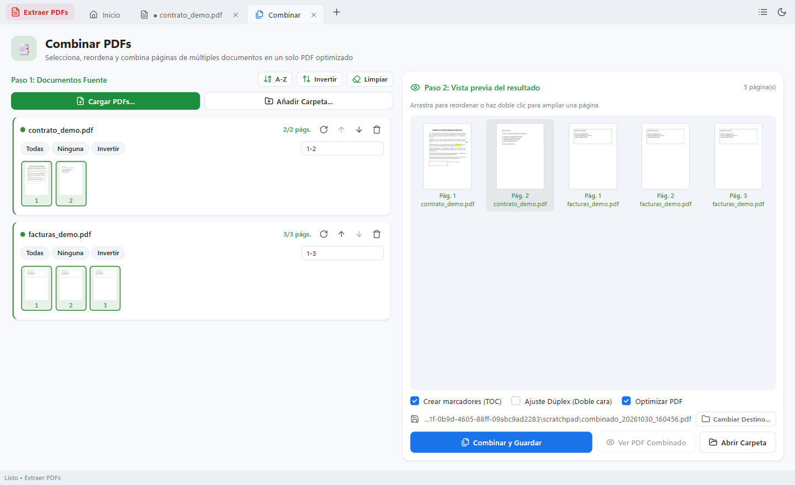
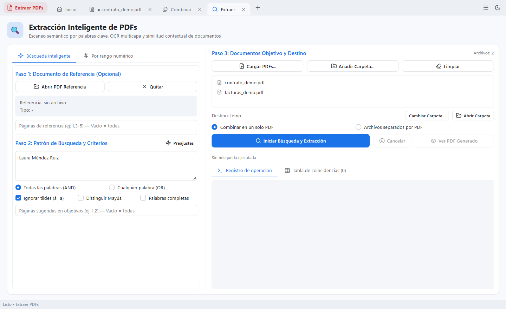
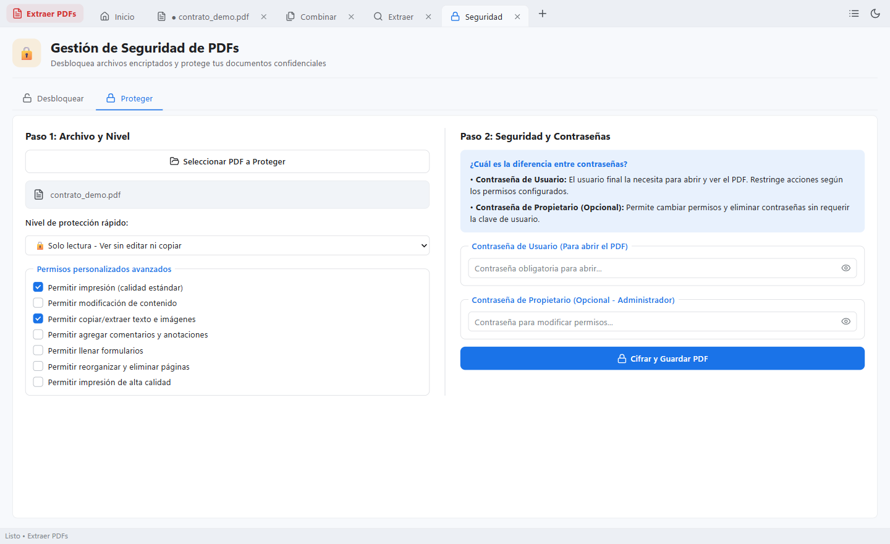

# PdfManager App

Aplicación de escritorio para Windows para ver, anotar, censurar y manipular archivos PDF, con OCR,
extracción por palabras clave, combinación y seguridad.



> **Versión web 0.1.30-beta-web: segunda versión de pruebas (beta).** La interfaz ahora usa tecnología web
> (Svelte) dentro de una ventana de escritorio (pywebview + WebView2), con el backend en Python. Todo
> el trabajo con PDF usa un solo motor, PDFium (licencia Apache/BSD). **La última versión estable
> sigue siendo la 0.1.28** (Flet), que queda en la rama `Flet`. Ver [docs/README.md](docs/README.md).

## Arquitectura

```
app/            aplicación: ventana (pywebview), arranque y servicios Python que llama la interfaz
app/ui/         interfaz en Svelte (compilada con Vite); el visor dibuja los PDF con EmbedPDF (PDFium)
src/pdf_core/   lógica de PDF sin interfaz (PDFium, OCR, censura, combinar, seguridad...)
installer/web/  ejecutable (PyInstaller) e instalador (Inno Setup)
docs/web/       documentación de la versión web
```

La interfaz llama a los servicios de Python con `call('servicio.metodo', ...)`. EmbedPDF es dueño
del documento abierto en el visor: dibuja las páginas y edita anotaciones, páginas y censura en la
ventana. Python lee y escribe los archivos y hace lo que EmbedPDF no puede (OCR, IA, orientación del
escaneo) y las herramientas de archivos (combinar, extraer y seguridad).

- **[Cómo funciona, paso a paso](docs/web/como-funciona.md)**: diagramas de cada flujo (arranque,
  abrir, guardar, OCR, censura, la versión de navegador…). El mejor sitio para empezar.
- [Arquitectura y reglas](docs/web/arquitectura.md) y el resto de la
  [documentación técnica](docs/web/README.md).

## Características

### 🏠 Inicio
Accesos a cada herramienta y archivos recientes. Cada PDF y cada herramienta se abren en su pestaña.



### 📖 Visor de PDF
- Zoom, scroll continuo, doble página o página única, miniaturas, índice y modo noche.
- Selección de texto (también entre páginas) y búsqueda con lista de resultados.
- **Anotaciones:** resaltar, subrayar, tachar, formas, flechas, pluma, texto libre, notas e imágenes.
  Se mueven, se redimensionan y se cambian de color, grosor y orden.
- **Sellos:** estándar (Aprobado, Borrador, Confidencial…), de texto (tus leyendas, editables como
  texto libre) y propios, creados desde una imagen (PNG, JPG, SVG) o desde anotaciones de la página.
- **Firmas:** dibujadas, escritas o desde una imagen, con iniciales opcionales. Se pueden guardar en
  el equipo para reutilizarlas. Es una firma visual, sin certificado digital.
- **Páginas:** girar, mover (también arrastrando miniaturas), duplicar, insertar, eliminar y extraer.
- Deshacer y rehacer (Ctrl+Z / Ctrl+Y) tanto las anotaciones como las operaciones de página.
- Imprimir con el diálogo de Windows/Edge (vista previa, páginas, orientación, color, márgenes,
  escala y doble cara), con las anotaciones y en calidad vectorial.
- Exportar el texto y las imágenes del documento, y **las páginas como imágenes** (PNG o JPG, a 96,
  150 o 300 ppp, con sus anotaciones).

📚 [Cómo está hecho el visor](docs/web/embedpdf.md)

### 🖼️ Imágenes a PDF
- Abre imágenes (PNG, JPG, WebP, BMP, GIF, SVG) desde Inicio, con Ctrl+O o arrastrándolas: cada una
  es una página de un **PDF nuevo** que se abre en el visor sin guardar (Ctrl+S → «Guardar como»).
- Tamaño de hoja (A4, Carta, Oficio, Legal, A5, A3 o el de la imagen), margen y encajar o rellenar.
- **Orientación automática** (cada página según su imagen) y, en las páginas que haga falta,
  **a mano** (vertical u horizontal), con la vista previa de todas las páginas tal como quedarán.
- Los JPG van tal cual (sin perder calidad) y las fotos del móvil salen derechas.
- En un PDF abierto: **insertar páginas desde imágenes** y **ajustar la imagen** de una página
  (otro tamaño, margen u orientación), con deshacer.

📚 [Guía de uso](src/assets/ayuda/06_IMAGENES%20A%20PDF.md) · [Cómo está hecho](docs/web/imagenes-pdf.md)

### 🖍️ Censura
Marca lo que hay que tapar y revísalo en la página antes de aplicarlo:
- frases, expresiones regulares y patrones de datos personales (correos, teléfonos, tarjetas, RFC/CURP...);
- texto seleccionado y áreas dibujadas a mano;
- perfiles de censura guardados.

Cada coincidencia es una marca que se puede mover, borrar o deshacer. Al aplicar, el contenido de
debajo se borra para siempre y el documento solo se guarda como copia.



### 🔍 OCR
Reconoce el texto de páginas escaneadas (página actual, recorte o documento entero) y corrige la
orientación. El texto reconocido se puede seleccionar, buscar, censurar y exportar.



### ✨ Asistente IA (en pruebas)
Chat sobre el documento, resumen, datos clave y detección de datos sensibles (que se envían a
Censura). Sin clave de API responde en modo básico.

> ⚠️ El agente de IA está **en fase de pruebas** y todavía no está probado del todo. Necesita un
> proveedor configurado en el panel del asistente (Gemini u OpenAI con su clave de API, o una IA local como Ollama);
> sin él solo funciona el modo básico.

### 📄 Combinar PDF
Une varios PDF eligiendo, girando y reordenando las páginas, con vista previa del resultado.



### 📊 Extraer
Busca en varios PDF por palabras clave (o por rango de páginas) y genera un PDF con las páginas
encontradas.



### 🔐 Seguridad
- **Proteger:** contraseña de usuario y de propietario (AES-256) y permisos.
- **Desbloquear:** quita la protección de un PDF del que se conoce la contraseña.



## 🧪 Qué está en fase de pruebas

La 0.1.30-beta-web es la **segunda versión de pruebas** (la primera fue la 0.1.29-web). Funciona en
general y pasa las pruebas automáticas, pero cambió mucho por dentro: el visor ahora es dueño del
documento y PyMuPDF se sustituyó por PDFium. Para trabajo importante, usa la 0.1.28 o guarda una
copia del PDF antes de editarlo.

Qué conviene probar con uso real:

| Aspecto | Qué probar |
|---|---|
| **Abrir y guardar** | PDF variados (escaneados, de Word, grandes, con contraseña, con formularios). Guardar, «Guardar como» y volver a abrir: que no falte nada y que la contraseña se conserve |
| **Páginas** | Girar, mover (también arrastrando miniaturas), insertar, duplicar, eliminar y extraer, con Ctrl+Z / Ctrl+Y en medio, y guardar al final |
| **Anotaciones, sellos y firmas** | Crearlas, editarlas, guardarlas y abrir el PDF en otro lector (Edge, Acrobat) para ver que se ven igual |
| **Censura** | Marcar, aplicar y guardar la copia; comprobar en otro lector que el texto tapado ya no se puede copiar ni buscar (tampoco el del OCR) |
| **OCR** | Página, área y documento entero en escaneos reales; corregir orientación; buscar y exportar el texto reconocido |
| **Imágenes a PDF** | Fotos del móvil (verticales y apaisadas), capturas, PNG con transparencia y SVG; orientación automática y a mano; insertar y ajustar páginas en un PDF abierto; exportar páginas como imágenes y abrir el PDF guardado en otro lector |
| **Imprimir** | Distintas impresoras y «Microsoft Print to PDF», con anotaciones y páginas giradas |
| **Asistente IA** | Con Gemini u OpenAI (clave de API) o con una IA local (Ollama, LM Studio). Sin proveedor responde en modo básico |
| **Combinar, Extraer y Seguridad** | Los diálogos de Windows para elegir archivos y carpetas, el progreso y los PDF que generan |
| **Sistema** | Instalar sobre la 0.1.29-web, «Abrir con», arrastrar PDF desde el Explorador, varias pestañas y reordenarlas, ventana pequeña |

Ya se sabe que:

- Imprimir ya no tiene orden inverso ni orientación automática por página (lo hace ahora el diálogo de Windows).
- El instalador no está firmado: Windows SmartScreen puede avisar al instalarlo («Más información» → «Ejecutar de todas formas»).

### Cómo avisar de un fallo

Abre un [issue](https://github.com/Mahynlo/pdf_manager/issues) con:

1. qué hiciste, qué esperabas y qué pasó (una captura ayuda);
2. la versión (se ve en **Ajustes**);
3. el registro de la app, `%USERPROFILE%\.pdf_manager\app.log` (o en **Ajustes → Ver Registro de Diagnóstico…**);
4. si se puede, el PDF que falla (o uno parecido sin datos privados).

## Instalación

Descarga el instalador `ExtraerPDFs_Web_Setup_<versión>.exe` de la página de
[Releases](https://github.com/Mahynlo/pdf_manager/releases). Añade «Abrir con» para los PDF y admite
arrastrar archivos a la ventana.

## Desarrollo

Requisitos: Windows, Python 3.10 o superior con [uv](https://docs.astral.sh/uv/), y Node.js con
pnpm (para compilar la interfaz).

```bash
git clone https://github.com/Mahynlo/pdf_manager.git
cd pdf_manager
uv sync
```

```bash
uv run python -m app.main            # arrancar (recompila la interfaz si cambió)
uv run python -m app.main --dev      # con el servidor de Vite: recarga al guardar
uv run python -m app.main --debug    # con herramientas de desarrollo (F12)
uv run pytest                        # pruebas
```

La primera vez, si falta `app/ui/node_modules`, se ejecuta `pnpm install` automáticamente. Más
detalles en [docs/web/svelte.md](docs/web/svelte.md).

## Compilación

```powershell
.\installer\web\build.ps1                  # ejecutable + instalador
.\installer\web\build.ps1 -SkipInstaller   # solo el ejecutable
```

El instalador necesita Inno Setup 6. En GitHub lo genera el workflow `build-web.yml` al subir una
etiqueta `v*-web` (por ejemplo `v0.1.30-beta-web`). Detalle en
[docs/web/instalador.md](docs/web/instalador.md).

## Versiones

Los cambios de cada versión están en [CHANGELOG.md](CHANGELOG.md). Su sección se genera a partir de
los commits (`uv run python installer/changelog.py add`) y es también el texto de la Release de GitHub.
Cómo publicar una versión y cómo escribir los commits: [docs/web/versiones.md](docs/web/versiones.md).


## Versión Flet

Se retiró de esta rama. Sigue disponible:

- **Instalador:** `v0.1.28`, la última versión de Flet, en
  [Releases](https://github.com/Mahynlo/pdf_manager/releases/tag/v0.1.28). Se puede instalar junto a
  la versión web, porque cada una tiene su propia carpeta e instalación.
- **Código tal como quedó en la 0.1.28:** rama [`Flet`](https://github.com/Mahynlo/pdf_manager/tree/Flet)
  (`git clone -b Flet https://github.com/Mahynlo/pdf_manager.git`).
