# Cómo funciona la app, paso a paso

Un recorrido con diagramas por lo que pasa dentro de la app cuando se usa: quién hace cada cosa, en
qué orden y por dónde viajan los datos. Está pensado para leerlo antes de tocar el código. Las reglas
y el detalle de cada parte están en los documentos enlazados al final de cada sección.

> Los diagramas son [Mermaid](https://mermaid.js.org): GitHub los dibuja solo. En VS Code hace falta la
> extensión «Markdown Preview Mermaid Support» para verlos en la vista previa.

**Contenido**

1. [Las piezas](#1-las-piezas)
2. [Arranque](#2-arranque)
3. [Una llamada y un evento](#3-una-llamada-y-un-evento)
4. [Datos grandes](#4-datos-grandes)
5. [Quién tiene el documento](#5-quién-tiene-el-documento)
6. [Abrir un PDF](#6-abrir-un-pdf)
7. [Editar y guardar](#7-editar-y-guardar)
8. [El texto de las páginas](#8-el-texto-de-las-páginas)
9. [OCR](#9-ocr)
10. [Censura](#10-censura)
11. [Lo que Python le pide al motor de la ventana](#11-lo-que-python-le-pide-al-motor-de-la-ventana)
12. [Trabajos largos: Extraer](#12-trabajos-largos-extraer)
13. [La misma app en un navegador](#13-la-misma-app-en-un-navegador)
14. [¿Dónde toco para…?](#14-dónde-toco-para)

## 1. Las piezas

La app son dos programas que se hablan: una **ventana** (una página web hecha con Svelte, dentro de
WebView2) y un **proceso de Python**. La ventana dibuja y recoge lo que hace el usuario; Python guarda
el estado, toca el disco y hace el trabajo pesado.

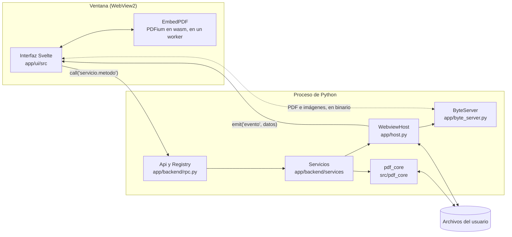

| Pieza | Qué es | Qué sabe hacer | Qué no hace nunca |
|---|---|---|---|
| **Interfaz** (`app/ui/src`) | Componentes Svelte | Pintar el estado, recoger clics y teclas | Decidir reglas (rangos, permisos): eso es de Python |
| **EmbedPDF** (`tools/viewer/canvas`, `lib/pdf-engine`) | PDFium compilado a wasm | Dibujar páginas, seleccionar y buscar texto, anotar, mover páginas, censurar | Escribir en el disco |
| **Api y Registry** (`backend/rpc.py`) | La única puerta de entrada a Python | Buscar el método pedido y devolver `{ok, value}` o `{ok, error}` | Ejecutar un método que no esté marcado con `@exposed` |
| **Servicios** (`backend/services`) | Uno por área: `viewer`, `merge`, `ocr`… | Guardar el estado de su área y validar | Importar pywebview (así se prueban sin ventana) |
| **pdf_core** (`src/pdf_core`) | Lógica de PDF sin interfaz | Unir, extraer, OCR, cifrado, capa de texto | Importar nada de `app/` |
| **WebviewHost** (`app/host.py`) | Lo único que conoce pywebview | Diálogos del sistema, eventos hacia la ventana, leer y escribir los archivos del visor | Lógica de PDF |
| **ByteServer** (`app/byte_server.py`) | Servidor en `127.0.0.1` | Pasar datos grandes en binario, una sola vez | Atender a nadie de fuera del equipo |

Los servicios no usan `WebviewHost` directamente, sino el **protocolo `Host`** (`backend/host.py`): una
lista de lo que pueden pedirle a la ventana. Por eso el mismo servicio funciona con tres «anfitriones»:

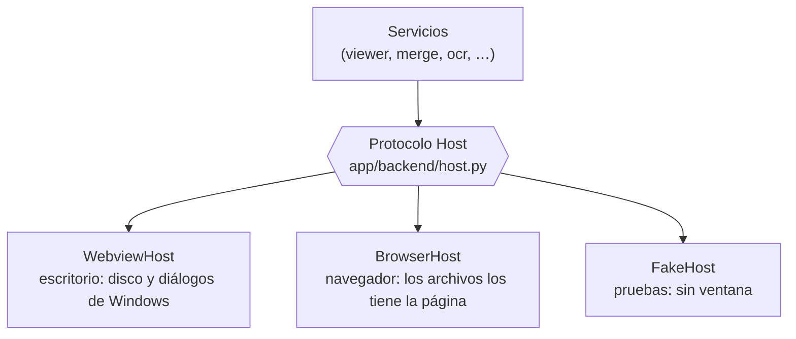

Más: [arquitectura.md](arquitectura.md), [modulos-python.md](modulos-python.md), [svelte.md](svelte.md).

## 2. Arranque

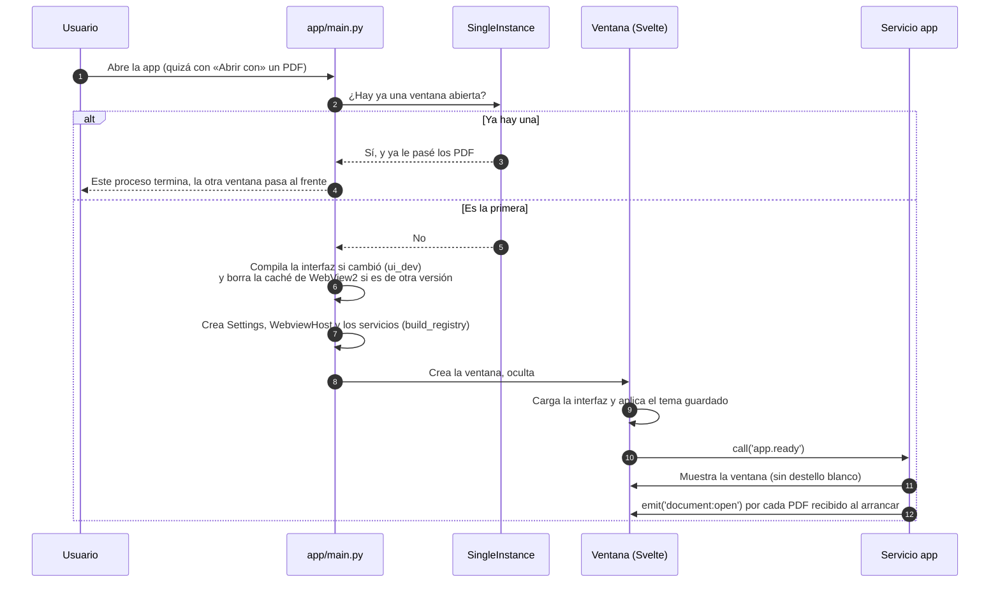

- La ventana nace **oculta** y se muestra cuando la interfaz ya tiene su tema: así no se ve un
  rectángulo blanco. Si la interfaz fallara al cargar, se muestra igual a los 3 segundos.
- **Instancia única**: la segunda vez que se lanza la app, sus PDF van a la ventana que ya existe
  (una lista de rutas en JSON por una tubería del usuario) y el proceso nuevo se cierra.

Más: [instalador.md](instalador.md) («Abrir con» e instancia única), [seguridad.md](seguridad.md).

## 3. Una llamada y un evento

Toda la comunicación son dos cosas: la ventana **llama** a Python y espera la respuesta; Python
**emite** eventos cuando quiere avisar de algo sin que se lo pidan.

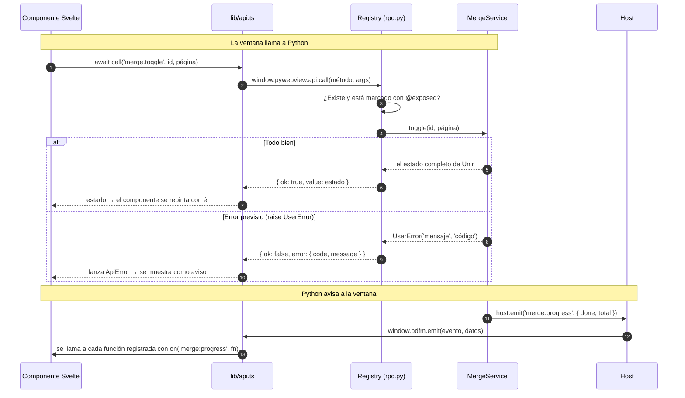

Tres reglas que explican casi todo el código:

1. **El estado vive en Python.** Cada llamada devuelve el estado completo y la ventana se repinta
   con él. La ventana no repite reglas.
2. **Un error que el usuario debe leer es un `UserError`.** Cualquier otra excepción llega como
   «Error inesperado» y queda en el registro (`~/.pdf_manager/app.log`).
3. **Cada llamada corre en su propio hilo.** Por eso cada servicio protege su estado con un candado,
   y `pdf_core/pdf.py` tiene un candado global: PDFium no admite dos hilos a la vez.

## 4. Datos grandes

El puente de pywebview lo convierte todo a texto JSON. Un PDF de 40 MB tardaría segundos. Lo grande
(un PDF, imágenes de páginas, el texto de un documento) va por un servidor local, en binario.

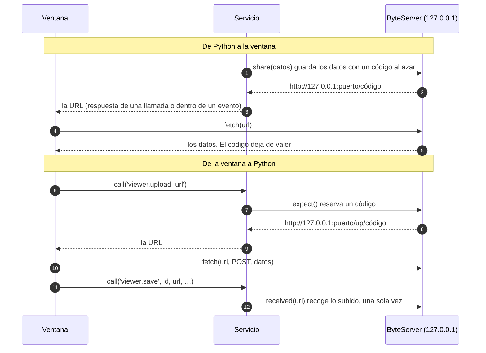

Cada URL sirve **una vez**, caduca a los 2 minutos y solo responde a peticiones dirigidas a
`127.0.0.1`. Más: [seguridad.md](seguridad.md).

## 5. Quién tiene el documento

Es la idea más importante del visor, y la que más sorprende: **el PDF abierto en el visor no está en
Python, está en EmbedPDF**. Python lo lee un momento al abrirlo y lo suelta.

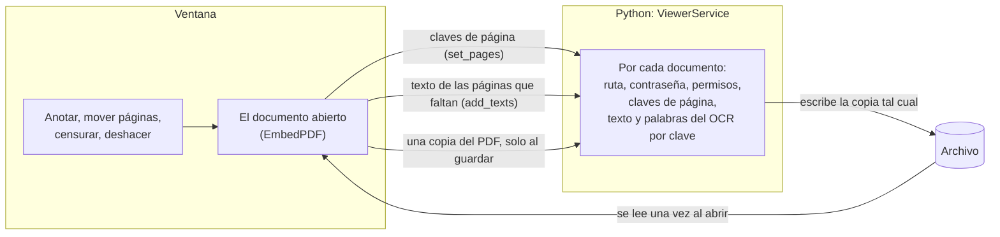

| | Documento del visor | Archivos de las herramientas (Unir, Extraer, Seguridad) |
|---|---|---|
| Quién lo abre | EmbedPDF, en la ventana | Python, con `pypdfium2` |
| Quién lo edita | EmbedPDF | Python (`pdf_core`) |
| Qué tiene Python | Lo justo para guardar y para leer su texto | El archivo |
| Cómo se accede al archivo | Con el `Host` (`read_file`, `write_file`, `file_url`) | Con su ruta |

**La clave de página** es `uid:giro:revisión` (por ejemplo `7:90:0`). El `uid` sigue a la página aunque
se mueva; el giro y la revisión cambian cuando cambia lo que se ve (girarla, censurarla). Con esa
clave Python guarda el texto y las palabras del OCR de cada página: si la clave no cambia, lo que
tiene sigue valiendo y no hay que volver a pedirlo.

Por qué se hizo así: antes el documento estaba dos veces en memoria y cada operación de página lo
serializaba entero. Ahora mover una página tarda 38–54 ms en un PDF de 47 MB (antes 330–550 ms).
Más: [embedpdf.md](embedpdf.md) («EmbedPDF, dueño del documento del visor»).

## 6. Abrir un PDF

Todas las formas de abrir (botón, Ctrl+O, recientes, arrastrar, «Abrir con», el resultado de Unir)
acaban en el mismo sitio: el evento `document:open`.

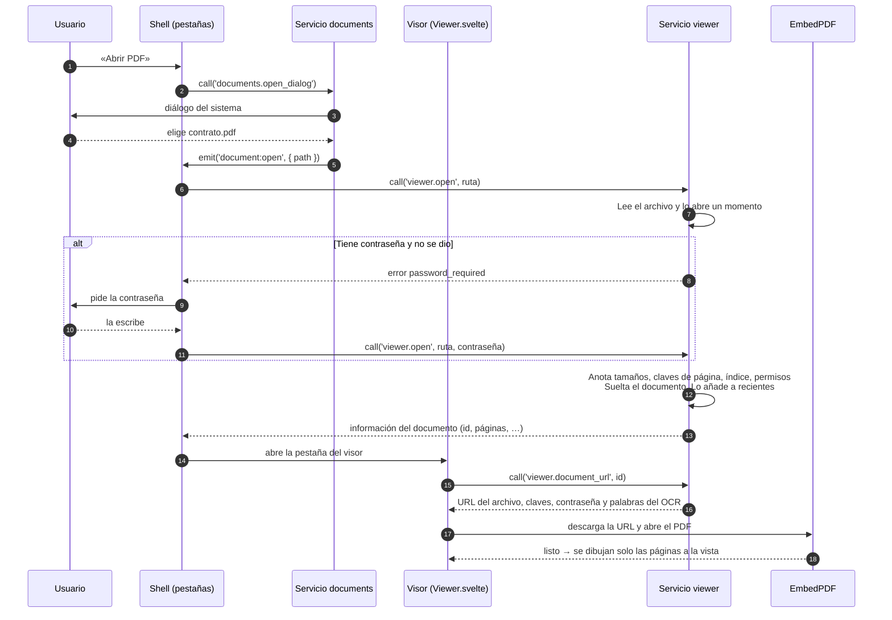

- Si el documento ya estaba abierto, `viewer.open` devuelve el mismo `id` y el shell cambia a su pestaña.
- El visor recibe el PDF **cifrado**, con su contraseña: así la copia que saque al guardar conserva
  el cifrado.
- Las páginas se dibujan en mosaico, solo las visibles y a la resolución del zoom.

## 7. Editar y guardar

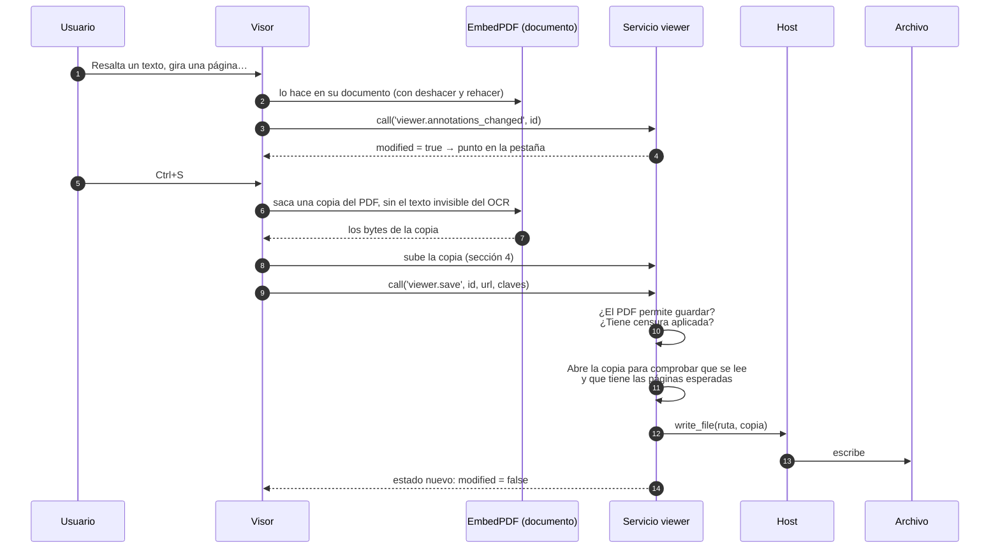

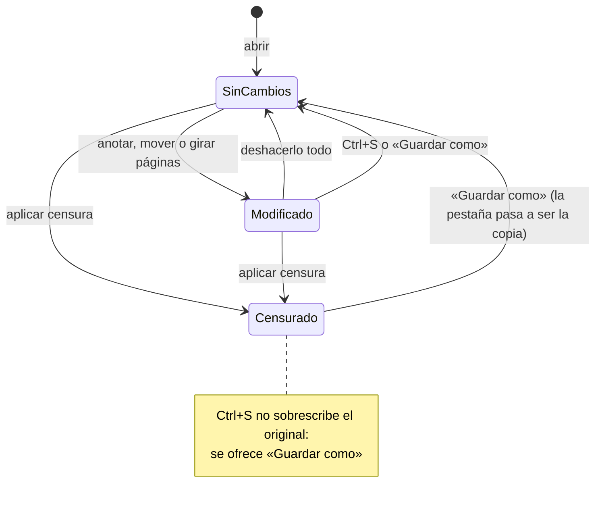

- Python **no vuelve a generar** el PDF: escribe la copia tal cual. Solo la abre antes para no
  escribir nunca un archivo que no se pueda leer.
- Si no hay permiso para sobrescribir (`permission_denied`) o el documento está censurado
  (`redacted`), el visor ofrece «Guardar como».
- El texto del OCR se quita de la copia: el archivo guardado no lleva texto invisible que el usuario
  no pidió. El documento a la vista lo conserva para seleccionar y buscar.

## 8. El texto de las páginas

El asistente IA, exportar texto, el panel del OCR y la búsqueda de la censura trabajan en Python, y
Python no tiene el documento. El visor le da el texto, pero solo el que le falta.

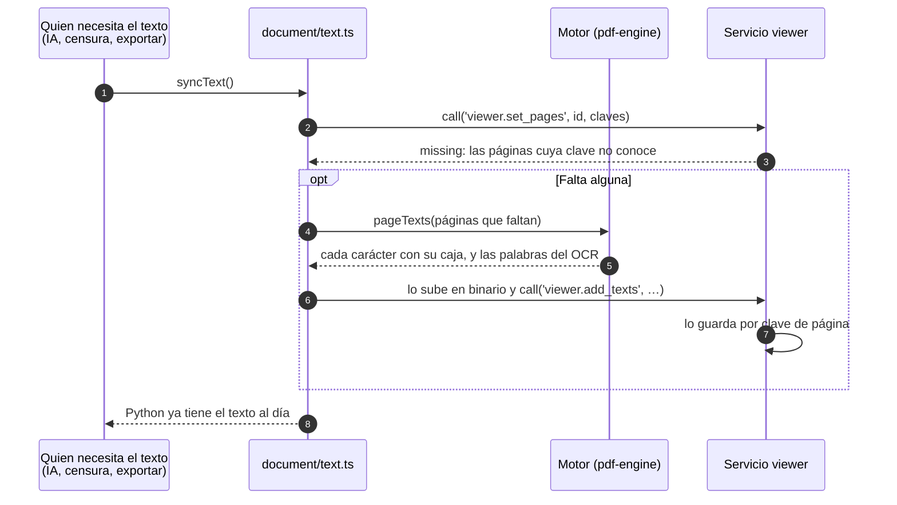

Cada versión de una página se extrae **una vez**: anotar o mover una página no cambia su clave, así
que no se vuelve a pedir. Más: [embedpdf.md](embedpdf.md) (etapas 4 y 5).

## 9. OCR

El reparto: **el motor de la ventana dibuja** lo que hay que reconocer y **escribe** el resultado en
el documento; **Python solo reconoce** (los modelos de PaddleOCR con onnxruntime).

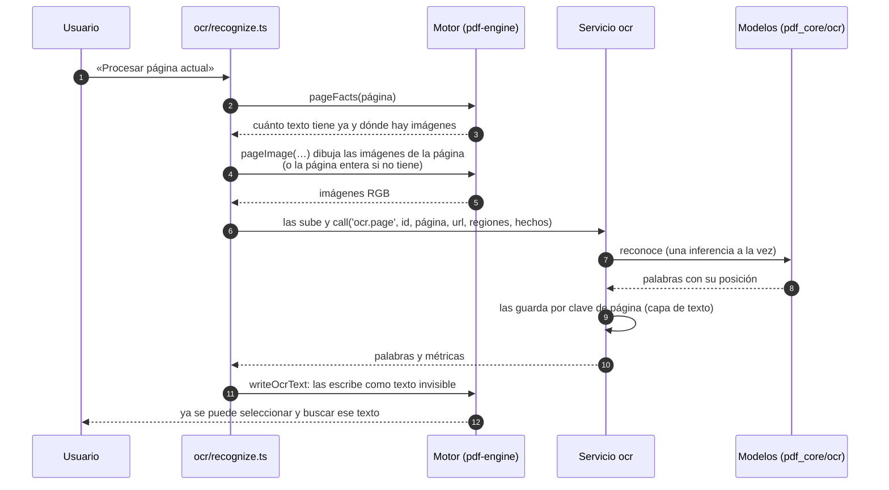

- **No se vuelve a abrir el documento** tras el OCR: el motor escribe el texto en el que está a la vista.
- El texto invisible lleva la marca `ExtraerPDFsOCR`: con ella se quita de las copias que se guardan.
- Los modelos se cargan la primera vez y se sueltan tras 12 segundos sin usarlos.
- Un lote lo recorre la ventana página a página, y por eso se puede cancelar entre una y otra.
- **Orientación**: si la página tiene texto, la dice el sentido de ese texto, sin llamar a Python; si
  es un escaneo, Python decide con un clasificador.

Más: [embedpdf.md](embedpdf.md) (etapa 3).

## 10. Censura

Se hace en dos tiempos a propósito: primero se **marca** (reversible, se revisa en la página) y luego
se **aplica** (irreversible).

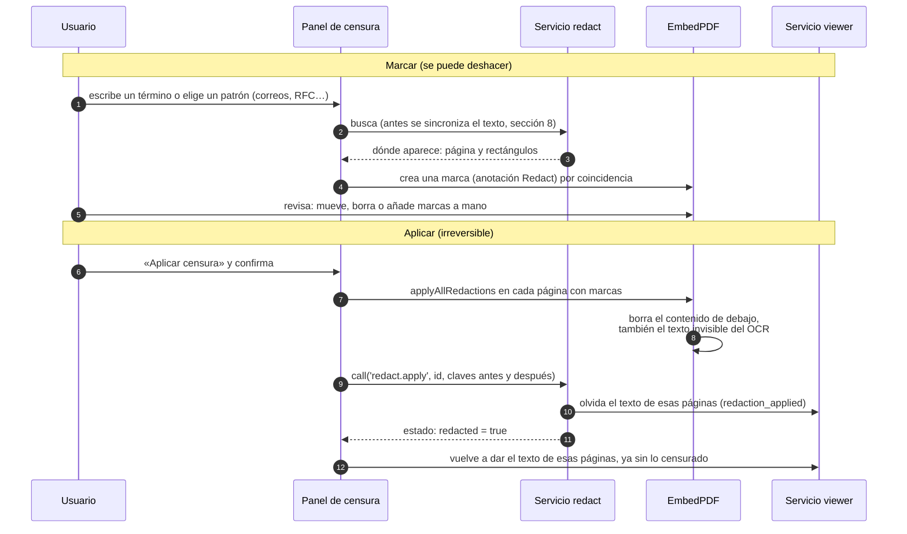

- Las páginas censuradas **cambian de clave** (sube su revisión): nada reutiliza su imagen ni su texto
  anteriores.
- Un documento censurado solo se guarda como copia; el original no se toca.
- Las opciones, el color y el perfil activo se guardan con el documento abierto, en Python.

Más: [embedpdf.md](embedpdf.md) («Censura»).

## 11. Lo que Python le pide al motor de la ventana

Hay dos cosas que el PDFium de Python no sabe hacer y el de EmbedPDF sí: **cifrar** (Seguridad →
Proteger) y **escribir marcadores** (Unir, con «Crear marcadores»). Python se lo pide a la ventana con
`host.run_engine` y espera.

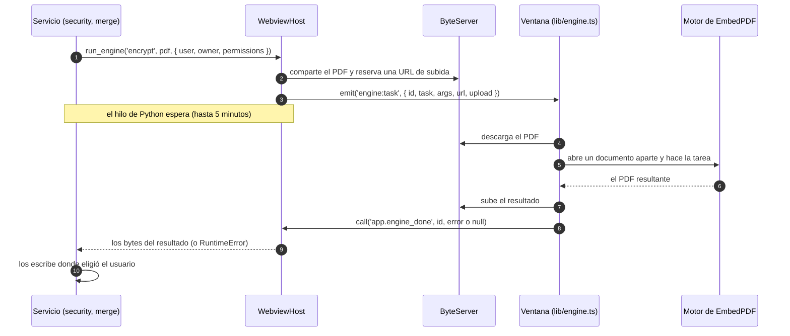

Las tareas están en `app/ui/src/lib/engine-tasks.ts`. Las pruebas de Python usan ese mismo código,
ejecutado en Node (`tests/engine_task.mjs`). Más: [embedpdf.md](embedpdf.md) («Un solo motor»).

## 12. Trabajos largos: Extraer

Un trabajo que tarda no puede ocupar la llamada que lo arranca. El servicio lo lanza en un hilo,
responde enseguida y el hilo va avisando con eventos.

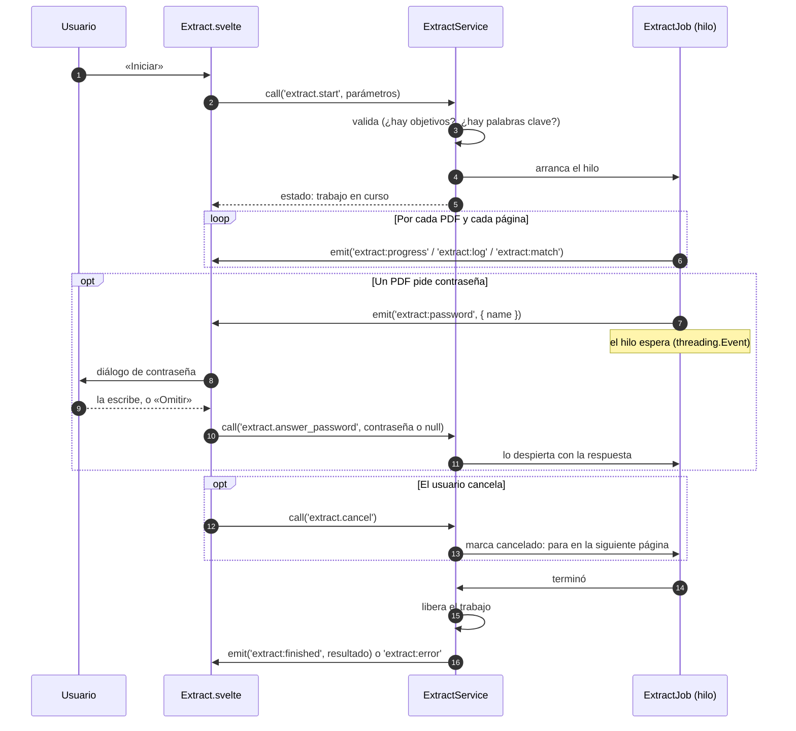

- El evento final se emite **después** de liberar el trabajo: la ventana puede lanzar otro en cuanto
  lo recibe.
- Mientras hay un trabajo, cerrar la pestaña o la ventana pregunta antes (`canClose()`, `quit_warnings`).
- Para un trabajo nuevo, copiar este patrón: `services/extract/` (`service.py` valida y lanza,
  `job.py` hace el trabajo y emite).

## 13. La misma app en un navegador

No hay una segunda implementación. Es el **mismo Python**, compilado a WebAssembly con Pyodide, dentro
de un worker. Solo cambia el anfitrión (`BrowserHost`) y lo que hay detrás de `lib/api.ts`.

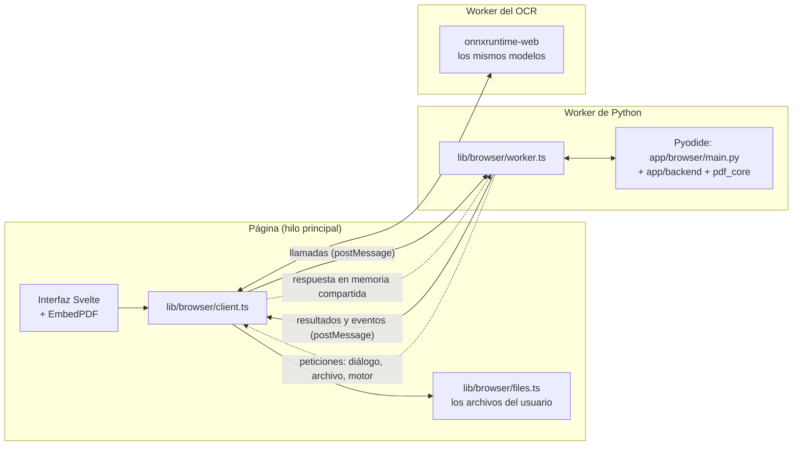

El problema que resuelve ese dibujo: los servicios son **síncronos**. `host.save_pdf()` devuelve la ruta
elegida, sin `await`. En el escritorio el hilo de Python simplemente espera al diálogo. En el
navegador, un worker bloqueado no puede recibir mensajes, así que la respuesta llega por **memoria
compartida**:

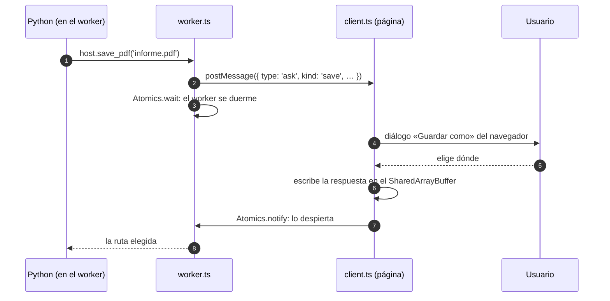

| En el escritorio | En el navegador |
|---|---|
| `WebviewHost` | `BrowserHost` (`app/browser/host.py`) |
| Hilos de `threading` | El trabajo se hace justo después de responder (`app/browser/background.py`) |
| `ByteServer` | URL `blob:` y `postMessage` |
| Rutas reales | Rutas virtuales `/files/…`; el archivo real lo tiene la página |
| `onnxruntime` | onnxruntime-web en otro worker (`app/browser/onnx.py`) |
| `~/.pdf_manager` | IndexedDB |

- La memoria compartida exige que el servidor envíe las cabeceras COOP y COEP. Sin ellas la página
  no arranca y lo dice en la pantalla de carga.
- `app/backend` no puede importar `js` ni `pyodide` (lo comprueba una prueba): lo propio del
  navegador va en `app/browser`.

Más: [navegador.md](navegador.md).

## 14. ¿Dónde toco para…?

| Quiero… | Empiezo por |
|---|---|
| Añadir una herramienta nueva | [arquitectura.md](arquitectura.md) («Añadir una herramienta»): servicio en `app/backend/services/`, componente en `app/ui/src/tools/`, entrada en `shell/tools.ts` |
| Añadir un botón que haga algo en Python | Un método `@exposed` en el servicio de su área y `call('servicio.metodo')` en el componente. Una prueba comprueba que cada `call` del frontend existe |
| Avisar a la ventana de algo | `self._host.emit('area:evento', datos)` en Python y `on('area:evento', fn)` en el componente |
| Mostrar un error al usuario | `raise UserError("mensaje", "código")` |
| Pasar un PDF o imágenes entre los dos lados | `host.share_bytes` / `host.upload_url` (sección 4), nunca como argumento de `call` |
| Cambiar algo del lienzo del visor (zoom, páginas, selección) | `app/ui/src/tools/viewer/canvas/` y [embedpdf.md](embedpdf.md) |
| Una operación nueva sobre el documento del visor | `app/ui/src/lib/pdf-engine/native.ts` (el motor) y `tools/viewer/document/` |
| Algo que el PDFium de Python no sabe hacer | Una tarea en `lib/engine-tasks.ts` y `host.run_engine` (sección 11) |
| Lógica de PDF para una herramienta | `src/pdf_core/`, siempre a través de `pdf_core/pdf.py` |
| Un texto de la interfaz | `app/ui/src/texts/es/` |
| Un color o un tamaño | `app/ui/src/styles/tokens.css` |
| Que funcione también en el navegador | Usar solo el `Host`; si hace falta algo nuevo de la página, añadirlo a `Host`, `WebviewHost`, `BrowserHost` y `FakeHost` |
| Un trabajo largo con progreso | Copiar `services/extract/` (sección 12). En el navegador, si se debe poder cancelar, añadir su método a `INTERRUPTS` (`lib/browser/protocol.ts`) |
| Publicar una versión | [versiones.md](versiones.md) |
