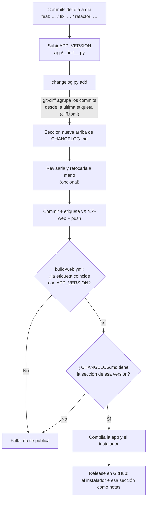

# Versiones y changelog

Cómo se publica una versión y cómo se escribe `CHANGELOG.md` sin hacerlo a mano.

## En corto

```powershell
uv run python installer/changelog.py preview   # qué entraría en la próxima versión
# 1. subir APP_VERSION en app/__init__.py (p. ej. "0.1.30-web")
uv run python installer/changelog.py add       # añade su sección a CHANGELOG.md
# 2. revisar la sección (se puede retocar a mano) y subirla con el cambio de versión
git tag v0.1.30-web
git push origin v0.1.30-web                     # GitHub compila y publica la Release
```

## Qué pasa en cada paso



- **Las secciones ya escritas no se regeneran.** `add` solo añade la de la versión nueva, encima de
  las demás. Por eso se puede mejorar el texto a mano (explicar un cambio, juntar varios commits en
  una línea) sin que se pierda después.
- **La Release usa esa misma sección** como notas (`changelog.py notes`): lo que se lee en GitHub es
  lo que está en `CHANGELOG.md`.
- **Sin sección no hay Release.** El workflow lo comprueba antes de compilar, así no se olvida.
- `add` no hace nada si la versión ya tiene sección (dice que se edite a mano) ni si no hay commits
  desde la última etiqueta.

## Cómo escribir los commits

El changelog es tan bueno como los mensajes de los commits. La primera línea es la que aparece:

```
feat: arrastrar pestañas para reordenarlas
fix: el visor no guardaba la contraseña de un PDF cifrado
refactor(ocr): el motor dibuja la página en vez de Python
```

| Prefijo | Sección del changelog | Para qué |
|---|---|---|
| `feat:` | Added | Algo nuevo que el usuario puede usar |
| `refactor:` | Changed | Cambia cómo está hecho o cómo se comporta algo que ya existía |
| `fix:` | Fixed | Arregla un fallo |
| `perf:` | Performance | Más rápido o con menos memoria |
| `security:` | Security | Seguridad |
| `docs:` | Documentation | Solo documentación |
| `test:` | Tests | Solo pruebas |
| `chore:`, `ci:`, `build:`, `style:` | Maintenance | Dependencias, workflows, formato |

- Entre paréntesis se puede decir la parte de la app: `fix(censura): …` sale como **censura:** ….
- Un commit **sin prefijo** también entra: se clasifica por cómo empieza la frase («Refactorización…»
  → Changed, «Implementar…» → Added, «Corregir…» → Fixed; si menciona el README o la documentación →
  Documentation) y, si no encaja en nada, va a *Other*. Las reglas están en
  [`cliff.toml`](../../cliff.toml) (`commit_parsers`).
- No aparecen los commits de mezcla (`Merge branch…`) ni los de «Versión X.Y.Z».
- Un commit, un cambio: «mejoras varias» no le dice nada a quien lee el changelog.

## Piezas

| Archivo | Qué hace |
|---|---|
| [`cliff.toml`](../../cliff.toml) | Configuración de [git-cliff](https://git-cliff.org): cómo se agrupan los commits y el formato de cada sección |
| [`installer/changelog.py`](../../installer/changelog.py) | `preview`, `add` y `notes`. Llama a git-cliff con `uvx` (versión fija) y escribe en `CHANGELOG.md` |
| [`.github/workflows/build-web.yml`](../../.github/workflows/build-web.yml) | Con una etiqueta `v*-web`: comprueba versión y changelog, compila y publica la Release |
| `tests/test_changelog.py` | Prueba la lectura y la inserción de secciones |

`APP_VERSION` (en `app/__init__.py`) es la versión de la app y del instalador. La de `pyproject.toml`
no se usa para publicar: solo admite versiones PEP 440, y «-web» no lo es.

El instalador y el workflow, en [instalador.md](instalador.md).
